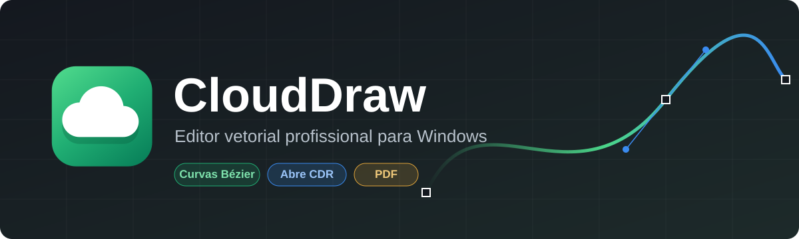
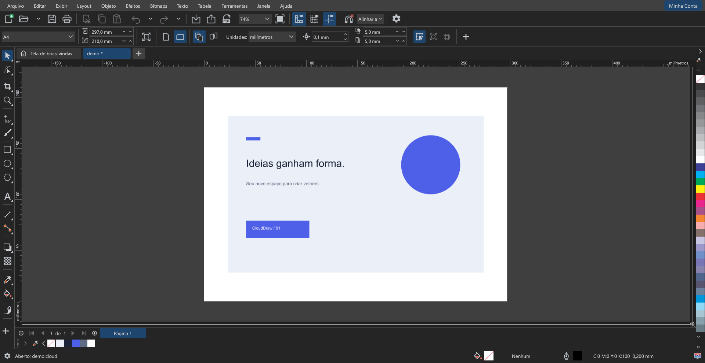
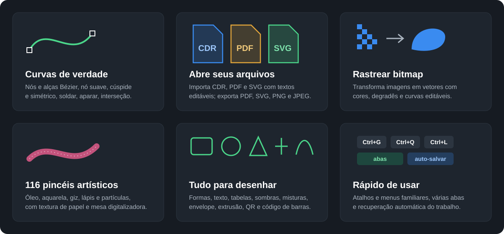

  

  <a href="https://github.com/cloudgraficaweb/clouddraw/releases/latest"><b>⬇ Baixar a última versão</b></a>
  &nbsp;·&nbsp;
  <a href="https://youtu.be/_JA23wW-xZ8">▶ Tutorial no YouTube</a>
  &nbsp;·&nbsp;
  <a href="https://cloudapp-web.pages.dev/">Assinar o Premium</a>

---

O **CloudDraw** é um editor de desenho vetorial para Windows, feito para quem cria
logotipos, cartões, banners, adesivos, artes para impressão e recorte. Atalhos, menus
e ferramentas são familiares para quem já usa outros editores vetoriais, e os seus
arquivos de outros programas abrem direto nele.

  

## O que ele faz

  

- **Curvas Bézier de verdade:** nós e alças editáveis com a ferramenta Forma (nó suave,
  cúspide e simétrico, adicionar, excluir, unir e separar), além de soldar, aparar,
  interseção, simplificar, combinar e criar limite.
- **Abre seus arquivos:** importa **CDR**, **PDF** e **SVG**, com textos que continuam
  editáveis, e exporta **PDF**, **SVG**, **PNG** e **JPEG**.
- **Rastrear bitmap:** transforma uma imagem em vetores (arte de linha, logotipo,
  clipart e imagem de alta qualidade), com cores, degradês e curvas editáveis.
- **116 pincéis artísticos:** óleo, aquarela, acrílico, giz, lápis, marcadores e
  partículas, com textura de papel e pressão da caneta da mesa digitalizadora.
- **Tudo para desenhar:** retângulo com cantos arredondados, vieira e chanfro; elipse,
  pizza e arco; polígonos, estrelas, espirais, texto, tabelas, sombras, misturas,
  contornos, envelope, extrusão, contorno variável, PowerClip, **código QR** e
  **código de barras**.
- **Rápido de usar:** vários documentos em abas, recuperação automática do trabalho,
  desfazer completo, réguas, guias, grade e alinhamento.

## Como instalar

  

1. Em [**Releases**](https://github.com/cloudgraficaweb/clouddraw/releases/latest),
   baixe o arquivo **`CloudDraw-Setup-X.Y.Z.exe`**.
2. Abra o instalador. Ele instala só para o seu usuário (não pede administrador) e cria
   os atalhos na área de trabalho e no menu Iniciar.
3. Abra o CloudDraw e entre com a sua **conta Premium**. Quem já usa o **CloudApp
   Vendas** neste computador entra direto, sem digitar nada.

As **atualizações chegam sozinhas**: ao abrir, o CloudDraw baixa a versão nova em
segundo plano (você continua trabalhando) e ela é instalada quando você fecha o programa.

## Requisitos

- Windows 10 ou 11 (64 bits).
- Conta **Premium** ativa (a mesma do CloudApp Vendas).
- Internet para entrar e para receber atualizações. Depois de entrar, o CloudDraw abre
  por até 3 dias sem internet.
- Para **Rastrear bitmap**: [Node.js](https://nodejs.org/) instalado.

## Perguntas frequentes

**Posso usar em dois computadores?**
Sim. A conta Premium aceita até 2 computadores. Para trocar de computador, use
**Minha Conta › Remover PC** (os logins ficam bloqueados por 12 horas).

**Meus desenhos ficam onde?**
No seu computador, onde você salvar. O CloudDraw também guarda uma cópia das abas
abertas para recuperar o trabalho se o programa fechar de repente.

**Como desinstalar?**
Em **Configurações › Aplicativos** (ou "Adicionar ou remover programas"), procure
**CloudDraw**. Seus desenhos não são apagados.

## Suporte

Dúvidas ou problemas? Fale com a gente no
[grupo de suporte](https://chat.whatsapp.com/DNMKYHKGSzm1JxBJLzHGXy).

---

© Cloud Gráfica. Todos os direitos reservados.

